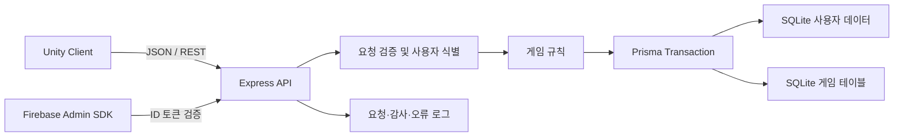

# NextHorizonServer

Unity 모바일 수집형 RPG **NextHorizon**의 인증, 플레이어 데이터, 인벤토리, 성장, 미션 및 스테이지 보상을 처리하는 REST API 서버입니다.

Node.js·Express와 SQLite·Prisma를 사용했으며, 클라이언트가 보낸 요청을 단순 저장하는 데 그치지 않고 게임 데이터 테이블을 기준으로 유효성을 검증하고 여러 데이터 변경을 트랜잭션으로 처리하도록 구현했습니다.

> 이 저장소는 1인 개발 프로젝트의 서버 구현과 AI 협업 과정을 보여주기 위한 포트폴리오입니다. 상용 운영 환경을 그대로 재현한 프로젝트는 아닙니다.

## 프로젝트 핵심 요약

| 항목 | 내용 |
|---|---|
| 역할 | NextHorizon Unity 클라이언트용 게임 API 서버 |
| 개발 형태 | 1인 설계·구현 |
| 주요 기술 | Node.js, Express 5, Prisma 7, SQLite, Firebase Admin SDK |
| 핵심 구현 | Google·Guest 계정, 플레이어 데이터, 캐릭터 성장, 장비, 미션, 스테이지 보상 |
| 데이터 처리 | 게임 테이블 검증, 원자적 보상 지급, 중복 수령 방지, 서버 마이그레이션 |
| 운영 보조 | 요청 ID, JSON Lines 로그, 감사 로그, KST 기준 로그 분리, PM2 배포 스냅샷 |
| AI 활용 | Codex를 영향 범위 분석, 오류 재현, 예외 검토, 테스트 설계 및 코드 리뷰에 활용 |

빠르게 확인하기:

- [서버 구조](#서버-구조)
- [핵심 구현](#핵심-구현)
- [대표 문제 해결 사례](#대표-문제-해결-사례)
- [Codex 활용과 AI 협업 경험](#codex-활용과-ai-협업-경험)
- [API 목록](#api-목록)
- [실행 방법](#실행-방법)

## 직접 수행한 작업

서버 요구사항 정의부터 데이터 모델, API, 게임 규칙, 오류 처리와 실행 검증까지 직접 담당했습니다.

- Unity 클라이언트 요청에 맞춘 REST API와 응답 DTO 설계
- Guest 계정과 Firebase ID 토큰 기반 Google 계정 인증 흐름 구현
- 사용자·캐릭터·아이템·장비·미션·스테이지 진행 데이터 모델 설계
- 캐릭터 및 장비 경험치 계산과 최대 레벨 처리 구현
- 장비 장착·교체·해제 규칙과 스테이지 장비 보상 지급 구현
- 일간·주간 미션 초기화, 진행도 누적 및 중복 수령 방지 구현
- 보상 지급과 데이터 갱신을 하나의 Prisma 트랜잭션으로 구성
- 기존 DB를 보존하면서 스키마와 데이터를 보정하는 시작 시 마이그레이션 작성
- 요청·감사·오류 로그와 종료 시그널 처리 구현
- 임시 DB 기반 미션 통합 테스트 작성 및 실제 API 응답 검증

## 서버 구조



| 파일 | 책임 |
|---|---|
| [`server.js`](server.js) | 서버 초기화, 인증, API 라우트, 공통 검증, 로그, DB 마이그레이션 |
| [`missions.js`](missions.js) | 미션 정의 검증, 주기 초기화, 진행도와 보상 처리 |
| [`game-time.js`](game-time.js) | KST 오전 4시 기준 일간·주간 게임 주기 계산 |
| [`equipment.js`](equipment.js) | 장비 생성, 참조 검증, 보조 능력치 부여와 초기 장비 지급 |
| [`prisma/schema.prisma`](prisma/schema.prisma) | 사용자 진행 데이터의 Prisma 모델 정의 |
| [`test-missions.js`](test-missions.js) | 임시 DB와 로컬 서버를 이용한 미션 통합 테스트 |
| [`MISSIONS.md`](MISSIONS.md) | 미션 API 규칙과 배포 시 주의사항 |

## 핵심 구현

### 1. Google·Guest 계정 인증

Google 로그인은 클라이언트가 전달한 Firebase ID 토큰을 Firebase Admin SDK로 검증한 뒤 서버 계정과 연결합니다. Guest 로그인은 로컬 ID를 별도로 관리하며, 기존 Guest 계정을 검증된 Firebase 계정으로 연결할 수 있습니다.

주요 처리:

- Firebase ID 토큰 검증 및 익명 Firebase 계정 거부
- 신규 Firebase 사용자와 기존 사용자 로그인 흐름 분리
- Guest 계정 생성 및 로그인
- Guest 계정의 Firebase 계정 연동
- 닉네임 길이와 계정 중복 검증
- 내부 숫자 ID 대신 공개 UID(`NH...`)를 이용한 클라이언트 요청 식별

### 2. 로그인 데이터 일괄 구성

로그인에 성공하면 플레이어 정보와 함께 캐릭터, 아이템, 방어구, 무기, 미션 및 스테이지 진행 상태를 조회해 하나의 사용자 DTO로 반환합니다. `BigInt` 경험치는 Unity에서 처리할 수 있는 숫자 형태로 변환하고, 서버 내부 필드는 응답에 그대로 노출하지 않도록 DTO를 분리했습니다.

### 3. 서버 권한 성장 처리

캐릭터와 장비의 성장 결과를 클라이언트 계산값으로 신뢰하지 않고, 서버가 게임 테이블과 보유 재료를 기준으로 다시 계산합니다.

- 캐릭터 경험치 카드와 장비 강화 카드의 종류·수량 검증
- 현재 레벨, 누적 필요 경험치와 최대 레벨 검증
- 소비 재료의 실제 보유 수량 확인
- 목표 레벨과 잔여 경험치 계산
- 재료 차감과 성장 결과 갱신을 하나의 트랜잭션으로 처리
- 안전한 정수 범위와 경험치 초과 입력 검사

### 4. 장비 획득 및 장착

방어구와 무기는 같은 종류라도 개별 인스턴스로 저장합니다. 획득 시 서버에서 보조 능력치를 부여하고, 장착 API는 캐릭터 소유 여부와 장비 종류를 확인한 뒤 기존 장비의 해제와 새 장비 장착을 함께 처리합니다.

- 무기와 모자·의상·장갑·신발 방어구 구분
- 장비 원본 테이블 키의 존재 여부 검증
- 장비별 레벨, 경험치, 보조 능력치와 장착 캐릭터 저장
- 동일 부위 교체 시 기존 장비 자동 해제
- 다른 사용자의 장비 ID 사용 방지

### 5. 미션 주기와 원자적 보상 지급

미션 정의는 DB의 `_104_Missions` 테이블에서 읽고, 진행 상태만 사용자별로 저장합니다. 일간 미션은 KST 매일 오전 4시, 주간 미션은 월요일 오전 4시를 기준으로 초기화합니다.

- 로그인, 경험치 카드 획득, 보상 수령 횟수 기반 진행도 누적
- 같은 게임 날짜의 로그인 진행도 중복 증가 방지
- 완료 여부, 이미 수령한 보상과 미션 주기 검증
- 조건부 갱신을 이용한 동시 중복 수령 방지
- 아이템과 플레이어 경험치 보상 구분
- 보상 지급, 계정 경험치 반영, 수령 상태 변경 및 연계 미션 진행을 하나의 트랜잭션으로 처리
- 잘못된 보상 키와 테이블 배열 불일치 감지

전투 결과를 검증할 서버 로직이 아직 없기 때문에 `Kill` 진행도는 클라이언트가 임의로 호출할 수 있는 API로 노출하지 않았습니다.

### 6. 스테이지 클리어 보상

스테이지 키와 클리어 시간을 검증하고, 스테이지 테이블에 연결된 방어구·무기 보상 그룹을 조회해 장비를 생성합니다. 보상 지급과 클리어 횟수 갱신은 하나의 트랜잭션으로 처리합니다.

### 7. 시작 시 DB 마이그레이션

별도 마이그레이션 도구만을 전제로 하지 않고, 기존 포트폴리오 DB를 실행 가능한 상태로 유지하기 위한 보정 로직을 서버 시작 과정에 포함했습니다.

- 적용 이력을 `__ServerMigration`에 기록해 중복 실행 방지
- 신규 컬럼과 상태 테이블 생성
- 기존 사용자 공개 UID 생성 및 고유 인덱스 구성
- 미션·스테이지·플레이어 경험치·장비 보조 능력치 데이터 보정
- 기존 사용자 초기 아이템 보완 및 잘못 저장된 경험치 아이템 정리

### 8. 관측 가능한 로그

모든 요청에 UUID 기반 요청 ID를 부여하고 `X-Request-Id` 응답 헤더로 돌려줍니다. HTTP 요청, 주요 데이터 변경과 처리되지 않은 오류는 동일한 요청 ID로 추적할 수 있습니다.

로그는 JSON Lines 형식으로 `.logs/YYYY-MM-DD-server.txt`에 기록하며, 파일 날짜와 타임스탬프는 실행 환경의 시스템 시간대와 무관하게 `Asia/Seoul`을 기준으로 계산합니다.

```json
{"timestamp":"2026-10-15T12:00:00.000+09:00","level":"info","event":"http_request","requestId":"...","method":"POST","path":"/api/mission/claim","statusCode":200,"durationMs":12.34}
```

## 대표 문제 해결 사례

| 문제 | 해결 | 결과 |
|---|---|---|
| 미션 보상 도중 일부 갱신만 성공할 가능성 | 수령 상태, 아이템, 경험치와 연계 진행도를 단일 Prisma 트랜잭션으로 묶고 실패 롤백 테스트 작성 | 부분 지급 없이 전체 성공 또는 전체 실패 보장 |
| 같은 미션 보상을 동시에 요청할 가능성 | `isClaimed: false` 조건을 포함한 갱신 결과가 정확히 1건인지 검사 | 중복 보상 수령 방지 |
| 클라이언트 계산값 조작 가능성 | 레벨 테이블, 보유 재료와 현재 데이터를 서버에서 다시 조회해 성장 결과 계산 | 성장 결과의 서버 권한 유지 |
| 일간·주간 초기화가 서버 시간대에 따라 달라지는 문제 | KST 오전 4시를 기준으로 게임 주기를 계산하는 순수 함수 분리 | 배포 환경 시간대와 무관한 동일한 초기화 시점 확보 |
| 기존 DB에 기능을 계속 추가해야 하는 상황 | 적용 이력을 가진 시작 시 마이그레이션과 데이터 보정 로직 구현 | 기존 포트폴리오 데이터를 유지하면서 기능 확장 |
| API 오류를 재현하기 어려운 문제 | 요청 ID와 구조화 로그, 주요 변경 감사 로그를 함께 기록 | 한 요청의 입력 경로와 실패 지점을 로그에서 추적 가능 |

## Codex 활용과 AI 협업 경험

Codex는 기능의 소유권을 대신하는 자동 생성 도구가 아니라, 여러 데이터 경로를 빠르게 탐색하고 구현을 검증하는 협업 도구로 활용했습니다.

주요 활용 범위:

- Unity 클라이언트, 서버 API와 Excel 기반 테이블 사이의 변경 영향 분석
- 요청·응답 구조와 DB 모델이 어긋나는 지점 탐색
- 보상 지급, 경험치 계산과 장비 교체 과정의 예외 조건 검토
- 임시 DB를 이용한 오류 재현과 회귀 테스트 항목 제안
- 트랜잭션 경계, 입력 검증과 중복 처리에 대한 코드 리뷰
- 배포용 `.live` 스냅샷과 개발 파일의 차이 점검
- README와 릴리즈 노트의 정보 구조 및 문구 초안 작성

AI가 제안한 내용은 실제 스키마, 게임 테이블과 Unity 클라이언트의 처리 흐름을 직접 대조한 뒤 선택적으로 반영했습니다. 요구사항과 데이터 구조의 결정, 최종 코드 수정, 실행 검증 및 결과에 대한 책임은 개발자인 제가 맡았습니다.

이 과정에서 다음과 같은 AI 협업 역량을 경험했습니다.

- 문제를 재현 가능한 입력과 기대 결과로 구체화
- 여러 저장소에 걸친 변경을 검증 가능한 단위로 분해
- AI의 제안을 코드와 실행 결과로 교차 검증
- 정상 경로뿐 아니라 경계값, 롤백과 중복 요청까지 검토
- AI 사용 내역과 직접 수행한 작업을 구분해 기록

## API 목록

| 분류 | Method | Endpoint | 역할 |
|---|---|---|---|
| 상태 | `GET` | `/health` | DB 연결 상태 확인 |
| 계정 | `POST` | `/api/user/login` | Guest 로그인 |
| 계정 | `POST` | `/api/user` | Guest 사용자 생성 |
| 인증 | `POST` | `/api/auth/firebase` | Firebase 로그인 |
| 인증 | `POST` | `/api/auth/firebase/create` | Firebase 사용자 생성 |
| 인증 | `POST` | `/api/auth/link` | Guest 계정에 Firebase 연결 |
| 프로필 | `PATCH` | `/api/user/nickname` | 닉네임 변경 |
| 프로필 | `POST` | `/api/player-info` | 플레이어 정보 조회 |
| 프로필 | `PATCH` | `/api/player-info/introduction` | 소개글 변경 |
| 프로필 | `PATCH` | `/api/player-info/portrait` | 대표 캐릭터 변경 |
| 아이템 | `POST` | `/api/item/acquire` | 아이템 또는 플레이어 경험치 지급 |
| 아이템 | `POST` | `/api/item/list` | 보유 아이템 조회 |
| 아이템 | `POST` | `/api/item/consume` | 아이템 소비 |
| 아이템 | `POST` | `/api/item/update` | 아이템 수량 변경 |
| 캐릭터 | `POST` | `/api/character/acquire` | 캐릭터 획득 |
| 캐릭터 | `POST` | `/api/character/list` | 보유 캐릭터 조회 |
| 캐릭터 | `POST` | `/api/character/upgrade` | 캐릭터 중첩 수량 변경 |
| 캐릭터 | `POST` | `/api/character/update` | 캐릭터 상태 변경 |
| 캐릭터 | `POST` | `/api/character/level-up` | 재료 기반 캐릭터 성장 |
| 장비 | `POST` | `/api/armor/list` | 보유 방어구 조회 |
| 장비 | `POST` | `/api/armor/equip` | 방어구 장착·해제 |
| 장비 | `POST` | `/api/weapon/list` | 보유 무기 조회 |
| 장비 | `POST` | `/api/weapon/equip` | 무기 장착·해제 |
| 장비 | `POST` | `/api/equipment/level-up` | 재료 기반 방어구·무기 성장 |
| 미션 | `POST` | `/api/mission/list` | 미션 진행 상태 조회 |
| 미션 | `POST` | `/api/mission/claim` | 완료 미션 보상 수령 |
| 스테이지 | `POST` | `/api/stage/clear` | 클리어 기록 및 장비 보상 지급 |
| 버전 | `GET` | `/api/version` | 최신 앱 버전과 다운로드 주소 조회 |

대부분의 게임 데이터 API는 요청 본문의 공개 `uid`를 내부 사용자 ID로 변환하여 사용합니다. Firebase 인증 API는 별도로 `firebaseToken`을 검증합니다.

## 실행 방법

### 요구 환경

- Node.js 18 이상
- npm
- SQLite 데이터베이스 파일
- Firebase 인증 API 실행 시 Firebase Admin SDK 자격 증명 환경

### 설치

```powershell
git clone https://github.com/GyoolTomato/NextHorizonServer.git
cd NextHorizonServer
npm install
npx prisma generate
```

저장소 루트에 `.env` 파일을 만들고 DB 경로와 포트를 지정합니다.

```env
DATABASE_URL="file:C:/GitHub/NextHorizonServer/dev.db"
PORT=3099
FIREBASE_PROJECT_ID="your-firebase-project-id"
```

Firebase 인증을 사용하려면 실행 환경에 Firebase Admin SDK가 사용할 수 있는 자격 증명을 별도로 설정해야 합니다. 서비스 계정 키와 `.env`는 저장소에 커밋하지 않습니다.

### 실행

```powershell
npm start
```

정상 실행 여부는 다음 요청으로 확인할 수 있습니다.

```powershell
Invoke-RestMethod http://localhost:3099/health
```

예상 응답:

```json
{"ok":true}
```

### API 호출 예시

```powershell
$body = @{ uid = "NH100000" } | ConvertTo-Json
Invoke-RestMethod -Method Post `
  -Uri "http://localhost:3099/api/player-info" `
  -ContentType "application/json" `
  -Body $body
```

## 테스트

미션 통합 테스트는 원본 DB를 임시 디렉터리에 복사하고 별도 포트로 서버를 실행한 뒤 실제 HTTP 요청과 DB 상태를 함께 검사합니다.

```powershell
node test-missions.js
```

검증 범위:

- KST 오전 4시 기준 일간·주간 경계
- 게임 날짜당 로그인 1회 반영
- 미션 목록과 보상 수령 API
- 중복 보상과 플레이어 경험치 분리 처리
- 보상 처리 실패 시 전체 롤백
- 잘못된 보상 키와 테이블 배열 구조 감지

## 배포 구조

루트는 개발 환경에서 포트 `3099`를 사용합니다. `.live`는 포트 `3000`으로 실행되는 배포 스냅샷이며 런타임 코드, Prisma 설정과 배포용 DB를 함께 관리합니다.

PM2 실행 예시:

```powershell
pm2 delete NHServer
pm2 start server.js --name NHServer --cwd C:\GitHub\NextHorizonServer\.live
pm2 save
```

운영 코드만 갱신할 때는 `.live/dev.db`를 개발 DB로 덮어쓰지 않아야 합니다. 데이터베이스 교체는 기존 사용자 데이터를 변경할 수 있으므로 코드 배포와 분리해 다룹니다.

## 현재 범위와 한계

- 포트폴리오 시연을 위한 단일 인스턴스 SQLite 서버입니다.
- 공개 `uid` 기반 게임 API는 현재 데모 클라이언트 연동을 위한 구조이며, 상용 서비스에서는 모든 보호 API에 세션 또는 액세스 토큰 검증을 추가해야 합니다.
- 요청 속도 제한, 분산 락, 비밀 관리 서비스와 자동 배포 파이프라인은 포함하지 않았습니다.
- 전투 판정 서버가 없어 Kill 미션 진행 API는 외부에 공개하지 않았습니다.
- `server.js`에 여러 기능이 집중되어 있어 라우트·서비스·저장소 계층으로 추가 분리할 여지가 있습니다.

## 관련 저장소

- [NextHorizon Portfolio](https://github.com/GyoolTomato/NextHorizon_Portfolio): 프로젝트 소개, 시연 이미지와 Android APK
- [NextHorizonTables](https://github.com/GyoolTomato/NextHorizonTables): Excel 기반 게임 원본 데이터
- [TableDataConverter](https://github.com/GyoolTomato/TableDataConverter): Excel 데이터를 Unity·서버용 테이블로 변환하는 도구
